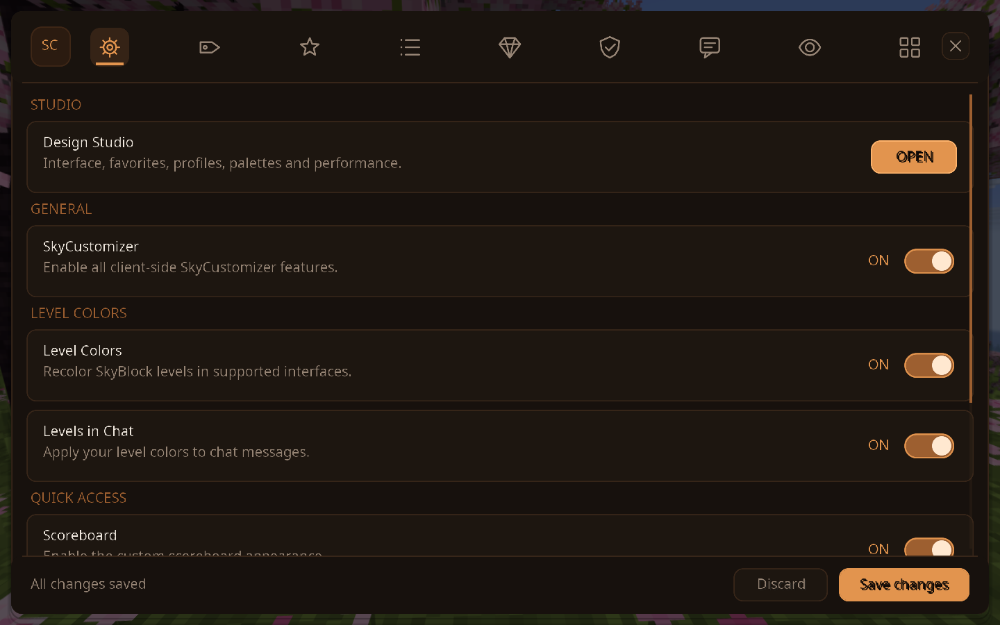
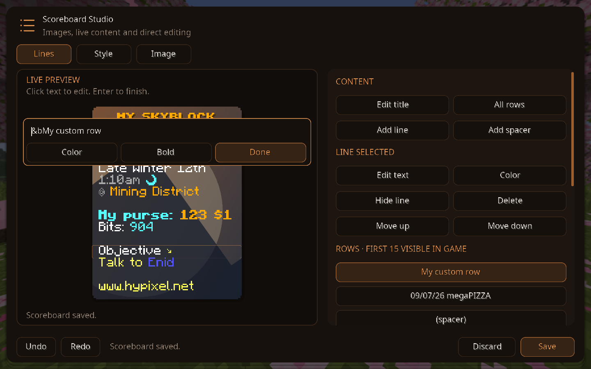
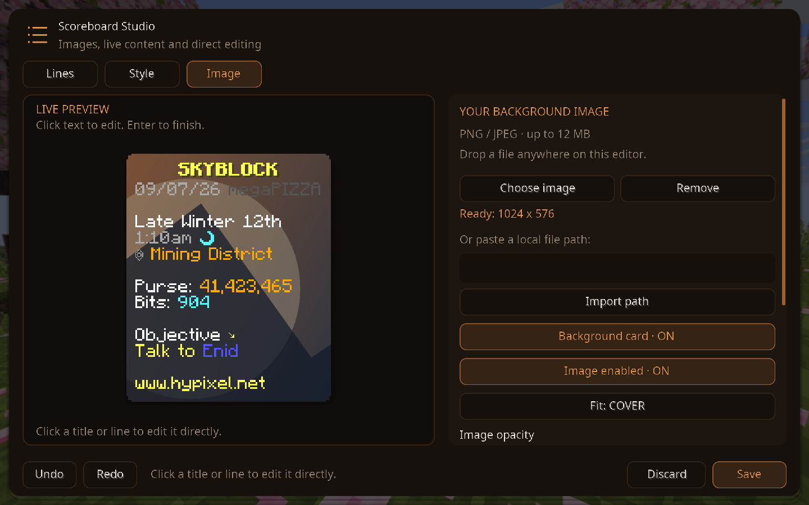
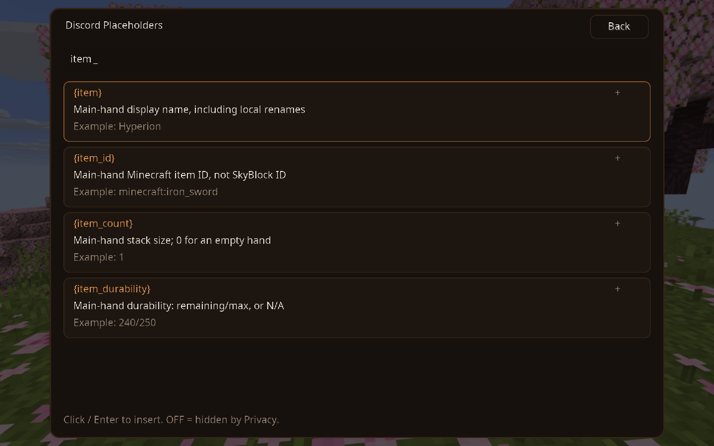
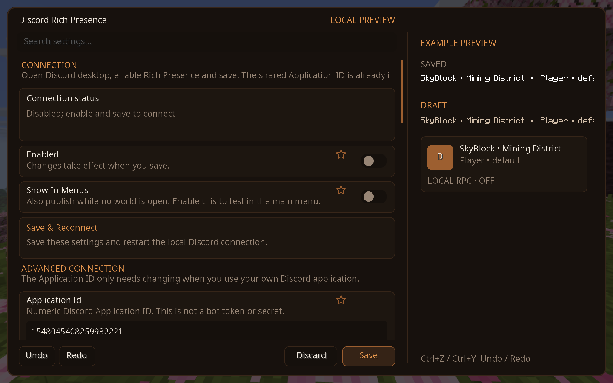

# SkyCustomizer

Client-side customizer for Hypixel SkyBlock on Minecraft 26.1.2 / Fabric. It changes only local presentation: no packets, item data, outgoing chat messages or server-side player names are modified.

## Open the menu

- Press **K**, run `/skycustomizer`, or use the shorter alias `/sc`.
- Mod Menu opens the same configuration screen.
- The UI and command feedback are English.

## What is available

### Names, levels and chat

- Custom player names with prefix, suffix, colors and effects.
- Local aliases and configurable nametag rules for self, exact players and level ranges.
- Editable level-color thresholds, gradients and optional chroma at high levels.
- Chat type colors, highlights, local filters, timestamps and compact duplicate messages.

### Items and armor

- `/sc itemname <text>` changes the displayed name of the held item.
- `/sc itemlore <text>` adds local tooltip lines; use `\\n` for a new line.
- `/sc itemreset` clears these local changes for the held item.
- The Item Editor also supports saved item overrides, name/lore rules, rarity colors and hide/force enchantment shine.
- Leather armor color can be set per piece or globally, including chroma.

### Scoreboard and HUD

Open **Scoreboard → Scoreboard Editor**.

- Click the scoreboard title or a row to edit it in place. Color and bold formatting are supported.
- Add rows or spacers, reorder them, hide rows and reset fixed server-row replacements back to live values.
- The editor supports 15 visible rows in-game and can reveal hidden/overflow rows for editing.
- Import a PNG or JPEG as the scoreboard background through the file picker, drag-and-drop or a local path. Cover, Contain and Stretch, image opacity and darkening are available.
- Imported images are copied to `config/skycustomizer/backgrounds`; original files remain unchanged.
- **Save** commits the staged changes. **Discard** leaves earlier saved settings intact. Undo/redo includes the editor content and image settings.
- The HUD editor positions and scales the scoreboard and actionbar with snapping and alignment guides.

### Screenshots







### Visuals

The active visual settings are custom title/subtitle colors, title chroma, title visibility, bossbar visibility, actionbar visibility and hiding the Minecraft vignette. The HUD editor positions the scoreboard, actionbar and FPS/ping/TPS performance widget. The Actionbar Composer can split matching health, defense and mana values into compact cards. The Item Editor includes Tooltip Canvas for pinning, moving and scaling tooltips.

### Discord Rich Presence

Open **General → Discord Rich Presence** to configure a local Discord activity. It is disabled by default and uses Discord IPC, so no bot token, web service or SkyCustomizer account is involved.

1. Open the Discord desktop app. SkyCustomizer already includes its shared Application ID; users do not need to create an application.
2. Turn on **Enabled**, then click **Save & Reconnect**. Enable **Show in menus** to test without entering a world.
3. Customize Details, State, images, timestamp, reconnect/update intervals and privacy switches. Clear an image key to hide that image.
4. As the Discord application owner, upload the included `docs/discord/skycustomizer_cover.png` once under **Rich Presence → Art Assets** with the key `skycustomizer_cover`. Other users do not need to upload anything.

Text supports `{player}`, `{area}`, `{profile}`, `{server}` and `{game}`. `{profile}` is the selected SkyCustomizer profile. Area detection reads the original server scoreboard, independently of local line replacements. Privacy switches decide which live values may be resolved; server sharing is off by default.

Click **{}** beside **Details**, **State**, **Large Image Text** or **Small Image Text** to open the searchable placeholder browser. Clicking an entry inserts it at the cursor or replaces the selected text; undo/redo is supported. Arrow keys select entries and Enter inserts one. Examples use the neutral name **Player**, not your account. Actual activity always uses live values.

Available placeholders:

- Identity: `{player}`, `{custom_name}`, `{area}`, `{profile}`, `{server}`, `{game}`, `{version}`, `{session}`.
- Equipment: `{item}`, `{item_id}`, `{item_count}`, `{item_durability}`, `{offhand}`, `{offhand_count}`, `{helmet}`, `{chestplate}`, `{leggings}`, `{boots}`. Display names include local item renames. The item ID is the Minecraft registry ID, not a SkyBlock item ID; durability is remaining/max or `N/A` for non-damageable items.
- Vanilla player stats: `{health}`, `{max_health}`, `{absorption}`, `{food}`, `{xp_level}`, `{xp_progress}`. These are **not** SkyBlock HP or SkyBlock level.
- Performance: `{fps}`, `{ping}` (milliseconds). Ping is empty when unavailable.
- Location: `{coords}`, `{x}`, `{y}`, `{z}`, `{dimension}`, `{biome}`. Coordinates are exact block positions; dimension and biome are Minecraft IDs. **Share Position is off by default.**

Equipment, stats, performance and location have separate **Privacy** switches. Disabled or unavailable values become empty; a genuinely empty hand shows `Empty` and a count of `0`. The editor preview uses examples and follows the same privacy switches, while the actual connection collects available data at most once per second and sends it at the configured update interval.

Example Details: `Using {item}`. Example State: `{area} • {fps} FPS • {ping} ms`.



**Connection status** reports `Activity confirmed by Discord` only after Discord acknowledges the activity. If it is confirmed but not visible, check activity sharing in Discord's **Activity Privacy** settings. `Waiting for a world` means **Show in menus** is off. If Discord is unavailable or restarts, the client retries automatically; **Save & Reconnect** also restarts the connection manually. The connection runs in background threads, not on Minecraft's rendering thread.



### Profiles and Design Studio

Profiles save and load complete configurations. The Design Studio manages interface animation, menu blur, color palettes, favorite settings, profile comparison and local frame-time measurements.

## Configuration compatibility

Old configuration files still load safely. The former global scoreboard-number option is migrated into the current scoreboard option. Removed placeholder settings are ignored when an older JSON file is read and are not written back on the next save.

## Build and verification

Requires Java 25.

```powershell
.\gradlew.bat build
.\gradlew.bat verifyHudLayout
.\gradlew.bat verifySourceUsage
.\gradlew.bat runUiSmoke
```

`build` runs the headless behavior checks and the source-usage check. The latter fails if a production method or field loses all references.

`runUiSmoke` starts an isolated development client in `build/ui-smoke-run`, tests the real menu hooks and exits automatically. Its test classes and test mod metadata are in `src/uiSmoke`; they are not packaged in the release JAR.

`verifyDiscordRpcLive` is an optional test against the locally running Discord desktop app. It briefly publishes a neutral connection-test activity using the shared Application ID, checks Discord's acknowledgement and clears it. Normal builds only run simulated IPC checks and never publish a Discord activity.

The release output is `build/libs/skycustomizer-1.0.0.jar`.
